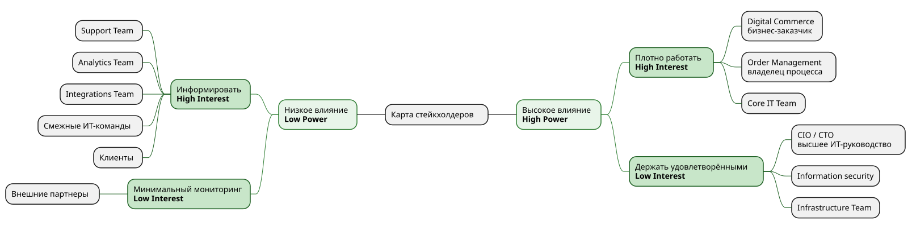
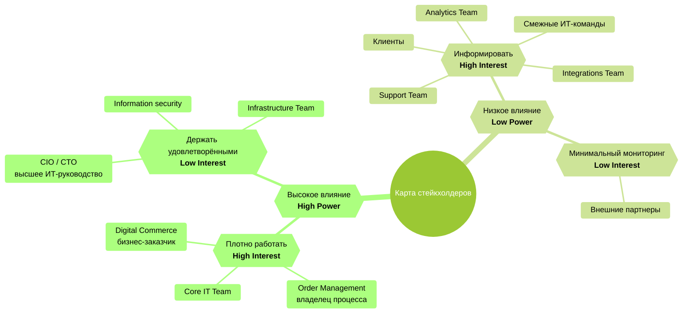

# Карта стейкхолдеров

Нам нужна карта стейкхолдеров, чтобы понимать у кого забирать требования, чьи системы будут изменяться, выявить кто может заблокировать внедрение, а также выстроить стратегию взаимодействия для каждого типа стейкхолдеров.

## Методология: матрица "Влияние / Интерес" (Influence / Interest)

- **High Power + High Interest**: ключевые игроки. С ними надо проводить регулярные сессии, согласовывать компромиссы, защищать архитектурные концепции. Это люди, которые определяют цели трансформации, дают бюджет и чьи команды будут непосредственно разрабатывать или использовать ядро новой системы.
- **High Power + Low Interest**: есть власть заблокировать проект и решения, но техническая сторона вопроса им не важна. Они выставляют жесткие рамки по инфраструктуре, безопасности и непрерывности процессов.
- **Low Power + High Interest**: у них нет власти отменить проект, но они дают самые ценные требования по Unhappy Path, т.к. будут страдать, если система сломается, их работа напрямую зависит от платформы. Если архитектор их проигнорирует, новая система "умрет" в реальной эксплуатации.
- **Low Power + Low Interest**: пользователи и системы на периферии, за которыми нужно наблюдать, чтобы они случайно не перешли в другую категорию.

| Стейкхолдер | Роль | Интерес | Влияние | Стратегия взаимодействия |
| -- | -- | -- | -- | -- |
| Director of Digital Commerce | Бизнес-заказчик | **Максимальный**: ускорить Time-to-Market коммерческих фич, стабилизировать пиковые нагрузки и избавиться от "героического" менеджмента | **Высокое**: утверждает архитектурную программу перехода и этапы финансирования, требует бизнес-ценность от каждого ИТ-шага | открыто обсуждать trade-offs, показывать бизнес-эффекты каждого перехода и четкие шаги траектории трансформации |
| Head of Order Management | Владелец процесса заказов | **Максимальный**: отвечает за ключевой процесс, страдает от исключений | **Высокое**: владеет процессом, знает реальное положение дел | регулярные сессии, совместное проектирование целевого процесса, исключений, ручных сценариев, SLA |
| Tech Lead Java Developer | Внутренняя Core ИТ-команда | **Высокий**: ежедневно сопровождают Java-монолит и базу данных Oracle, трансформация системы напрямую меняет их стек и зону ответственности | **Высокое**: владеют уникальными историческими и "племенными" знаниями системы, могут оказывать скрытое сопротивление, защищая локальные решения | вовлекать в проектирование To-Be схемы, делать их соавторами изменений, снижать их "технологический долг" и убирать ночные дежурства |
| Infrastructure Lead | Инфраструктурная команда | **Средний**: им важна стабильность "железа" и системы в целом, а не бизнес-логика | **Высокое**: физические серверы в собственном ЦОД близки к пределу, виртуализация ограничена, закупки долгие. Могут заблокировать решение, если оно потребует мгновенного выделения больших мощностей | согласовывать требования к ресурсам сильно заранее, закладывать постепенный отказ от Oracle и оптимизацию хранения данных |
| CIO / CTO | Высшее ИТ-руководство | **Средний**: стратегическая устойчивость ИТ-ландшафта, импортонезависимость | **Высокое**: утверждает архитектуру и бюджет, может заблокировать | согласовывать архитектурные принципы, показывать соответствие стратегии |
| Information security Lead | Служба безопасности | **Низкий к коммерции, средний к регуляторике**: им важно только соблюдение правил безопасности, а не бизнес, не производительность и т.д. | **Высокое**: жесткий тренд на импортозамещение и отказ от зарубежных компонентов | заложить в целевую архитектуру (To-Be) миграцию на open-source СУБД (например, PostgreSQL) как одно из долгосрочных направлений |
| Head of Customer Support | Команда технической поддержки | **Максимальный**: поддержка сейчас выступает "ручным адаптером" для легаси-ошибок. На пиках нагрузки они первыми принимают удар | **Низкое/Среднее**: непосредственно на бизнес-цели или на бюджет не влияют, но остро транслируют боли клиентов | использовать как главный источник требований для Unhappy Path, заложить в требования наблюдаемость и единую историю заказа для операторов |
| Logistics Senior Developer | Смежные ИТ-команды | **Высокий**: границы их сервисов (.NET) размыты с монолитом, изменение ядра затронет их API и интеграционные таблицы в Oracle | **Среднее**: хотя это и не Core-функционал, но в значительной сьтепени влияет на опыт конечных пользователей | согласовать новые контракты API, мигрировать с обмена через БД на события, дать им время на адаптацию |
| Analytics Senior Python Developer | Команда аналитики и отчётности | **Высокий**: нужны стабильные данные для отчётов, единый источник правды для метрик | **Среднее**: не блокируют проект, но создают нагрузку на Oracle и зависят от изменений в схеме данных | согласовать контракты данных, вынести аналитику в отдельное DWH/Data Lake, зафиксировать SLA на данные |
| Payment Integration Lead | Команда платёжных интеграций | **Высокий**: отвечает за платежи, критичный контур | **Среднее**: зависит от изменений в ядре | согласовать новые контракты, учесть fallback-сценарии |
| Клиенты | Конечные пользователи | **Максимальный**: хотят понятный статус, точные сроки, стабильный checkout | **Низкое**: не участвуют в проекте напрямую, но их опыт — главный критерий успеха для бизнеса | использовать как источник требований к UX/прозрачности через поддержку и бизнес-заказчика |
| Маркетплейсы, Службы доставки, Платежные провайдеры | Внешние партнеры | **Низкий**: не имеет значение, какая архитектура у RetailCore, пока соблюдаются API-контракты | **Среднее/Низкое**: мы не можем изменить их системы, мы подстраиваемся под их API | мониторить изменения их API-контрактов, изолировать внутреннюю систему от их сбоев с помощью паттернов проектирования |

Та же самая схема, просто для проверки, как будет рендериться in-page вариант в формате Mermaid

