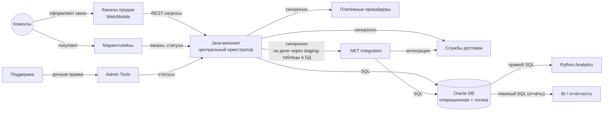

# Architecture Communication Canvas — RetailCore

*System: RetailCore — платформа заказов, логистики и партнёрских интеграций*
*Created by: Дмитрий*
*Date/Iteration: 2026-10-01, итерация 1*

---

## Value Proposition 💼

**Что за система**: RetailCore — внутренняя платформа розничного ретейлера для управления заказами, логистикой и взаимодействием с партнёрами. Через неё проходят оформление заказов, расчёт стоимости, выбор доставки и оплаты, интеграции с маркетплейсами, складами, службами доставки и платёжными провайдерами. Платформа это критичный контур для бизнеса. Любая нестабильность немедленно отражается на выручке, конверсии и лояльности клиентов.

**Ключевые бизнес-цели**:

- **Устойчивость базового order flow** — система критична для выручки, нельзя допускать деградации
- **Скорость вывода коммерческих изменений** — сократить time-to-market для промо, партнёрских сценариев, новых каналов
- **Прозрачность и управляемость данных** — единая картина по заказам для маркетинга, операций, финансов
- **Гибкость платформы** — возможность подключать новые сервисы, партнёров, каналы без страха сломать ядро
- **Подготовка к трансформации** — постепенный отказ от Oracle и зарубежных компонентов

**Главный бизнес-драйвер**: повысить скорость и предсказуемость изменений при сохранении устойчивости критичного контура.

---

## Core Functions 📋

**Операционный контур**:

- **Оформление заказа** (checkout): выбор товаров, расчёт цены, применение скидок и промо
- **Обработка заказа**: проверка данных, резерв товаров, вызовы внешних систем
- **Управление статусами**: жизненный цикл заказа
- **Платёжная оркестрация**: создание платёжных сессий, взаимодействие с провайдерами
- **Маршрутизация доставки**: выбор партнёра, резервирование слота

**Контур интеграций**:

- **Интеграция с маркетплейсами**: приём заказов, обновление статусов
- **Интеграция с логистикой**: REST + очереди + staging-таблицы + batch
- **Интеграция с платежами**: синхронные вызовы провайдеров
- **Интеграция через .NET-сервис**: партнёрские сценарии, обмен через БД

**Контур аналитики**:

- **Отчётность по заказам**: разнородные пайплайны (SQL, staging, API, CSV)
- **Витрины данных**: несколько представлений
- **BI-отчёты**: внутренние потребители аналитики

**Вспомогательные функции**:

- **Внутренние инструменты**: ручные проверки и корректировки статусов
- **Управление промо**: частично через внешний сервис, частично через legacy core и Oracle

---

## Key Stakeholders 🧑‍🧑‍🧒

| Стейкхолдер | Роль | Интерес | Влияние |
| -- | -- | -- | -- |
| **Director of Digital Commerce** (Дмитрий) | Бизнес-спонсор | Скорость изменений, устойчивость | Утверждает бюджет и программу |
| **CIO / CTO** | Высшее ИТ-руководство | Стратегическая устойчивость, импортонезависимость | Утверждает архитектуру |
| **CISO** | Служба безопасности | Регуляторика, комплаенс | Может заблокировать |
| **Head of Order Management** | Владелец процесса заказов | Реальный flow, исключения | Владеет процессом |
| **Tech Lead Java-монолита** (Андрей) | Core-команда | Стабильность, техдолг | Владеет знаниями о монолите |
| **Senior Developer логистики** (Ирина) | Команда логистики | Единый контур, дедупликация | Владеет интеграциями |
| **Senior Python Developer** (Максим) | Команда аналитики | Единый источник правды | Владеет аналитикой |
| **Head of Customer Support** (Ольга) | Поддержка | Прозрачность, наблюдаемость | Транслирует боли клиентов |
| **Клиенты** | Конечные пользователи | Прозрачность заказа | Лояльность клиентов — критерий успеха проекта |
| **Внешние партнёры** | Маркетплейсы, логистика, платежи | Стабильность API | Внешняя зависимость |

**Кто платит за разработку**: бизнес (через бюджет трансформации)
**Кто платит за операции**: ИТ-дирекция (on-premise, поддержка)
**Кто ключевой потребитель**: клиенты + операционные команды

---

## Quality Requirements ⭐️

| Категория | Требование | Приоритет |
| -- | -- | -- |
| **Устойчивость** | Order flow должен выдерживать пиковые сезонные нагрузки без деградации | Критический |
| **Наблюдаемость** | Сквозной мониторинг прохождения заказа с фиксацией отклонений | Критический |
| **Прозрачность** | Единая картина по заказу для клиента и внутренних пользователей | Критический |
| **Масштабируемость** | Слои обработки и данных выдерживают рост нагрузки | Критический |
| **Согласованность** | Время рассинхронизации статусов не превышает [X] | Высокий |
| **Latency** | Данные для оператора обновляются с задержкой не более [X] | Высокий |
| **Модифицируемость** | Типовые коммерческие изменения запускаются быстрее | Высокий |
| **Гибкость** | Новые сервисы/каналы/партнёры подключаются без изменения ядра | Высокий |
| **Безопасность** | Соответствие регуляторным требованиям, импортонезависимость | Высокий |

---

## Business Context 🔗

**Ключевые внешние интерфейсы**:

- **Маркетплейсы** — приём заказов, обновление статусов
- **Платёжные провайдеры** — синхронное взаимодействие
- **Службы доставки** — REST + очереди + таблицы + batch
- **BI / аналитика** — прямые SQL в операционную БД

## Core Decisions - Good or Bad 🚦
*Which decisions lead to the current state of the system?*

Большинство решений были вынужденными в условиях жёстких сроков. Система работает, но на пределе связности и предсказуемости.

| ## | Решение | Оценка | Последствия |
| -- | -- | -- | -- |
| 01 | Монолит как центральный оркестратор | Спорное | Высокая связность, сложность выноса |
| 02 | Бизнес-логика в Oracle-процедурах и пакетах | Очень плохое | Блокирует вынос сервисов, невидима при анализе кода |
| 03 | Обмен через staging-таблицы (между .NET и Oracle) | Плохое | Побочные эффекты, хрупкость |
| 04 | Синхронные вызовы платежей и логистики в транзакции оформления | Плохое | Длинные транзакции, деградация на пиках |
| 05 | Логика цены/промо размазана по коду, БД, конфигам | Плохое | Непредсказуемость, сложность изменений |
| 06 | Статусы размазаны по 4 местам в системе | Плохое | Расхождение модели и реальности |
| 07 | Аналитика через прямые SQL в операционную БД | Плохое | Конкуренция за ресурсы, деградация |
| 08 | Ручные вмешательства в жизненный цикл заказа | Вынужденное | "Племенные знания", немасштабируемость |
| 09 | On-premise инфраструктура без виртуализации | Спорное | Ресурсы на пределе, долгое масштабирование |
| 10 | Точечные изменения под срочные бизнес-запросы | Вынужденное | Накопление техдолга, "Big Ball of Mud" |

## Technologies 🛠️

| Слой | Технология | Роль |
| -- | -- | -- |
| Ядро | Java (монолит) | Центральный оркестратор |
| Данные | Oracle | Операционная БД + бизнес-логика + staging |
| Аналитика | Python | Аналитические пайплайны |
| Вспомогательные | .NET | Логистика и т.д. |
| Интеграции с внешними системами | REST, очереди, batch, staging-таблицы | Разнородный контур |
| UI | Web / Mobile | Каналы продаж |
| Админ | Web UI | Ручные правки |
| Инфраструктура | On-premise, физические серверы | Ограниченная виртуализация |
| BI | Разрозненные инструменты | Отчётность |

## Components / Modules 🧊

**Ядро (Java-монолит)**:

- **Checkout / Order API** — создание и обновление заказа
- **Order Processing** — обработка, резерв, вызовы
- **Pricing / Promo Logic** — расчёт цены, скидок
- **Status Management** — управление статусами
- **Payment Orchestration** — инициация платежей
- **Delivery Routing** — выбор маршрута доставки

**Данные**:

- **Oracle DB** — и как операционная БД, и бизнес-логика, и staging таблицы, и справочники, и витрины

**Вспомогательные сервисы**:

- **.NET Integration Service** — партнёрские интеграции
- **Python Analytics Jobs** — аналитические выгрузки

**Инфраструктура**:

- **Async / Batch Exchange** — очереди, задания, выгрузки
- **Admin / Support Tools** — ручные проверки и корректировки

## Core Risks and Missing Information ❓

**Ключевые риски**:

| ## | Риск | Влияние |
| -- | -- | -- |
| 01 | Высокая связность монолита (попытка вынести кусок вскрывает скрытые зависимости) | Блокирует трансформацию |
| 02 | Логика в Oracle-процедурах, невидима при анализе кода | Блокирует вынос сервисов |
| 03 | Нет единого источника правды (код, таблицы, логи, люди не синхронизированы) | Потеря доверия к данным |
| 04 | Длинные транзакции — деградация на пиках | Влияет на выручку |
| 05 | Аналитика конкурирует с операционным контуром за Oracle | Деградация производительности |
| 06 | Слабая наблюдаемость (цепочку по заказу собрать воедино сложно) | Разбор инцидентов превращается в ручную работу |
| 07 | "Племенные знания" (логика держится на людях) | Риск потери знаний |
| 08 | Разнородные интеграции и нет стандарта | Дубли, зачастую ручной разбор |
| 09 | Статусы не соответствуют реальности | Противоречия для клиента и поддержки |
| 10 | On-premise на пределе | Долгое масштабирование и риск сбоев |

**Отсутствующая информация**:

| ## | Отсутствует | У кого уточнять |
| -- | -- | -- |
| 01 | RTO/RPO системы | Сопровождение |
| 02 | p95, RPS, пиковые значения | Сопровождение |
| 03 | SLA/SLO системы | Сопровождение |
| 04 | Требования к консистентности | Разработка |
| 05 | Бюджет трансформации | Бизнес-спонсор |
| 06 | Целевые метрики (time-to-market, снижение инцидентов) | Бизнес-спонсор |
| 07 | Приоритеты между направлениями | Бизнес-спонсор |
| 08 | Определение что значит "статус завис" | Сопровождение |
| 09 | Доля сложных кейсов | Сопровождение |
| 10 | Инфраструктурные ограничения | Разработка / Сопровождение |

**Что мешает команде доставлять ценность быстрее**:

- **Связность монолита** — любое изменение затрагивает несколько слоёв
- **Бизнес-логика в Oracle** — невидима, требует экспертизы
- **Разнородные интеграции** — каждое подключение новое
- **Ручные операции** — не масштабируются, но они превалируют
- **Отсутствие наблюдаемости** — долгий разбор инцидентов
- **"Племенные знания"** — риск потери знаний о системе, медленный onboarding

 Software Architecture Canvas is licensed under Attribution-ShareAlike 4.0 International. 
[https://canvas.arc42.org](https://canvas.arc42.org)
