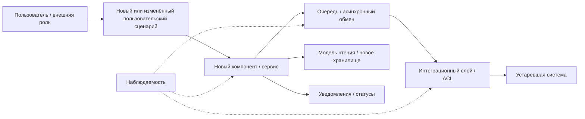

# transformation.md

## Назначение документа

Этот документ описывает трансформацию текущей системы в целевую архитектуру ближайшего этапа. Его задача — показать не только **что нужно изменить**, но и **почему именно эти изменения выбраны**, какие ограничения учитываются, какие проблемы текущего состояния они решают и как будет проверяться эффект.

Документ заполняется после интервью, анализа текущего состояния, выявления препятствий и выбора точек трансформации.

---

## 1. Бизнес-цель

Опишите, какую бизнес-проблему должна решить трансформация и какой измеримый эффект ожидается.

### Формулировка цели

> [Кратко опишите цель: что должно улучшиться для пользователя, бизнеса, операционной команды или технической устойчивости системы.]

### Контекст цели

| Параметр | Описание |
|----|----|
| Текущая проблема | [Что сейчас работает плохо или создаёт потери] |
| Кого затрагивает | [Пользователи, операторы, поддержка, бизнес, ИТ, партнёры] |
| Желаемое изменение | [Что должно измениться после ближайшего этапа] |
| Горизонт изменений | [Например: первый релиз, пилот, квартал, сезон] |
| Ожидаемый эффект | [Снижение времени, ошибок, повторных обращений, нагрузки, рисков] |

### Проверочный вопрос

> Если эту трансформацию не сделать, какая бизнес-цель окажется недостижимой?

---

## 2. Уточнённые требования

Покажите, как исходные требования изменились после интервью, анализа процесса, данных, интеграций и ограничений текущей системы.

| Исходная формулировка | Что показали интервью и анализ AS-IS | Уточнённое требование для ближайшего этапа | Обоснование |
|----|----|----|----|
| [Исходное требование] | [Что выяснилось после анализа] | [Новая рабочая формулировка] | [Почему требование нужно изменить] |
| [Исходное требование] | [Что выяснилось после анализа] | [Новая рабочая формулировка] | [Почему требование нужно изменить] |
| [Исходное требование] | [Что выяснилось после анализа] | [Новая рабочая формулировка] | [Почему требование нужно изменить] |

### Минимальная проверка

Уточнённое требование должно отвечать на вопросы:

- что именно должна делать система;
- в каких границах это должно работать;
- какие состояния, исключения или ограничения нужно учитывать;
- как пользователь или операционная роль увидит результат.

---

## 3. Ограничения

Зафиксируйте условия, которые ограничивают выбор решения. Ограничение — это не просто проблема, а рамка, внутри которой нужно проектировать ближайший этап.

| Ограничение | Тип ограничения | Как влияет на решение | Можно ли изменить в ближайшем этапе |
|----|----|----|----|
| [Что нельзя менять или что ограничено] | [Технологическое / организационное / срок / бюджет / данные / безопасность / инфраструктура] | [Какие варианты решения становятся невозможными] | [Да / Нет / Частично] |
| [Что нельзя менять или что ограничено] | [Тип] | [Влияние] | [Да / Нет / Частично] |
| [Что нельзя менять или что ограничено] | [Тип] | [Влияние] | [Да / Нет / Частично] |

### Проверочный вопрос

> Какие решения выглядели бы правильными технически, но невозможны из-за этих ограничений?

---

## 4. Препятствия текущего состояния

Опишите проблемы AS-IS, которые мешают достижению бизнес-цели. Не все препятствия станут точками трансформации: часть окажется техническим долгом, будущими работами или ограничениями.

| Препятствие | Где проявляется | Влияние на бизнес-цель | Причина в текущей архитектуре или процессе | Доказательство / источник |
|----|----|----|----|----|
| [Проблема текущего состояния] | [Процесс / данные / интеграция / компонент / роль] | [Как мешает цели] | [Почему возникает] | [Интервью / логи / метрики / схема / наблюдение] |
| [Проблема текущего состояния] | [Где проявляется] | [Влияние] | [Причина] | [Источник] |
| [Проблема текущего состояния] | [Где проявляется] | [Влияние] | [Причина] | [Источник] |

### Рекомендация

Формулируйте препятствие как связку:

> **Проблема → последствие → почему это мешает цели.**

Например: «Система ждёт синхронный ответ устаревшего компонента → пользователь долго не получает статус → цель быстрого онлайн-сценария не достигается».

---

## 5. Точки трансформации

Точка трансформации — это участок системы, процесса, данных или интеграций, который нужно изменить в ближайшем этапе, потому что он мешает бизнес-цели, реализуем в известных ограничениях и проверяется метрикой.

| Точка трансформации | Какое препятствие закрывает | Что меняем | Почему это можно сделать сейчас | Ожидаемый эффект | Метрика проверки |
|----|----|----|----|----|----|
| [Название точки] | [Связанное препятствие] | [Процесс / данные / интеграция / компонент / состояние] | [Почему входит в ближайший этап] | [Какой эффект ожидается] | [Метрика] |
| [Название точки] | [Связанное препятствие] | [Что меняем] | [Почему сейчас] | [Эффект] | [Метрика] |
| [Название точки] | [Связанное препятствие] | [Что меняем] | [Почему сейчас] | [Эффект] | [Метрика] |

### Проверка качества точки трансформации

Для каждой точки проверьте три условия:

1. Она связана с бизнес-целью.
2. Она реализуема в ближайшем этапе.
3. Её эффект можно измерить.

---

## 6. Не точки трансформации

Зафиксируйте важные проблемы, которые **не входят в ближайший этап**. Это нужно, чтобы команда не смешивала текущий объём трансформации с долгосрочной программой модернизации.

| Элемент | Почему важен | Почему не входит в ближайший этап | Как учитывать дальше |
|----|----|----|----|
| [Проблема / доработка / долгосрочная цель] | [Почему это важно] | [Ограничение, риск, несоответствие горизонту, нет метрики, слишком большой объём] | [Реестр рисков / будущий этап / отдельная инициатива] |
| [Элемент] | [Почему важен] | [Почему не сейчас] | [Как учитывать] |
| [Элемент] | [Почему важен] | [Почему не сейчас] | [Как учитывать] |

### Типовые причины исключения

- нельзя изменить в ближайшем релизе;
- нет прямой связи с бизнес-целью текущего этапа;
- эффект нельзя проверить метрикой;
- изменение слишком крупное и требует отдельной программы;
- сначала нужно собрать данные или стабилизировать процесс.

---

## 7. Приоритизация

Опишите, в каком порядке нужно внедрять изменения и почему. Приоритет должен учитывать бизнес-эффект, риски, зависимости, реализуемость и возможность измерения.

| Приоритет | Изменение / точка трансформации | Обоснование приоритета | Зависимости | Риск откладывания |
|----:|----|----|----|----|
| 1 | [Самое важное изменение] | [Почему нужно делать первым] | [От чего зависит] | [Что случится, если отложить] |
| 2 | [Следующее изменение] | [Почему после первого] | [Зависимости] | [Риск] |
| 3 | [Следующее изменение] | [Почему после предыдущих] | [Зависимости] | [Риск] |

### Рекомендуемые критерии приоритизации

| Критерий | Вопрос |
|----|----|
| Бизнес-эффект | Как сильно изменение влияет на цель? |
| Риск | Что произойдёт, если изменение не сделать? |
| Зависимость | Является ли изменение основой для следующих шагов? |
| Реализуемость | Можно ли сделать это в ближайшем этапе? |
| Проверяемость | Есть ли метрика результата? |
| Обратимость | Можно ли безопасно откатить изменение? |

---

## 8. Целевая архитектура первого этапа

Опишите, как должна работать система после ближайших изменений. Это не финальная архитектура всей программы, а целевое состояние **первого управляемого этапа**.

### Краткое описание TO-BE

> [Опишите целевое состояние: какие компоненты появляются или меняются, как меняется процесс, где проходят границы нового контура, что остаётся в старом контуре, как обеспечивается безопасное сосуществование.]

### TO-BE диаграмма

Вставьте диаграмму целевой архитектуры первого этапа. Можно использовать C4, Mermaid, PlantUML или другую согласованную нотацию.

### Компоненты целевой архитектуры

| Компонент | Роль в TO-BE | Новый / существующий / изменяемый | Ответственность | Важные ограничения |
|----|----|----|----|----|
| [Компонент] | [Что делает] | [Новый / существующий / изменяемый] | [За что отвечает] | [Что важно учитывать] |
| [Компонент] | [Что делает] | [Тип] | [Ответственность] | [Ограничения] |
| [Компонент] | [Что делает] | [Тип] | [Ответственность] | [Ограничения] |

### Изменение поведения

| Сценарий | Как работает сейчас | Как будет работать после первого этапа | Что должно быть видно пользователю или операционной роли |
|----|----|----|----|
| [Сценарий] | [AS-IS] | [TO-BE] | [Пользовательское / операционное поведение] |
| [Сценарий] | [AS-IS] | [TO-BE] | [Что видно] |

---

## 9. Разрыв

Опишите разрыв между текущим и целевым состоянием. Разрыв показывает, что нужно изменить в процессах, данных, интеграциях, состояниях и компонентах, чтобы перейти от AS-IS к TO-BE.

| Область | AS-IS | TO-BE первого этапа | Что нужно изменить |
|----|----|----|----|
| Процессы | [Как работает сейчас] | [Как должно работать] | [Изменения в шагах, ролях, правилах] |
| Данные | [Какие данные и где сейчас] | [Какие данные, модели, владельцы нужны] | [Новые поля, модели чтения, владельцы, миграции] |
| Интеграции | [Текущие связи] | [Новые или изменённые связи] | [Очереди, API, ACL, контракты, ретраи] |
| Состояния | [Текущая модель статусов] | [Целевая модель статусов] | [Новые статусы, переходы, правила отображения] |
| Компоненты | [Текущие компоненты] | [Новые / изменённые компоненты] | [Что создать, изменить, изолировать или оставить] |
| Наблюдаемость | [Что измеряется сейчас] | [Что нужно видеть после изменений] | [Метрики, логи, алерты, дашборды] |
| Операционная модель | [Как работают роли сейчас] | [Как должны работать после изменений] | [Инструкции, ответственность, ручные ветки] |

### Проверочный вопрос

> Какие изменения нужно выполнить, чтобы TO-BE не осталось только схемой, а стало рабочим состоянием системы?

---

## 10. Метрики

Опишите, как будет проверяться эффект трансформации. Метрики должны быть связаны с бизнес-целью, препятствиями и точками трансформации.

| Метрика | Что проверяет | Базовое значение AS-IS | Целевое значение | Источник данных | Период контроля |
|----|----|----:|----:|----|----|
| [Метрика] | [Какой эффект показывает] | [Текущее значение] | [Цель] | [Логи / BI / мониторинг / CRM / опрос] | [Ежедневно / еженедельно / после релиза] |
| [Метрика] | [Что проверяет] | [AS-IS] | [TO-BE] | [Источник] | [Период] |
| [Метрика] | [Что проверяет] | [AS-IS] | [TO-BE] | [Источник] | [Период] |

### Связь метрик с точками трансформации

| Точка трансформации | Метрика | Что будет считаться успехом | Что будет сигналом проблемы |
|----|----|----|----|
| [Точка] | [Метрика] | [Критерий успеха] | [Порог тревоги] |
| [Точка] | [Метрика] | [Критерий] | [Порог] |

---

## 11. Риски и открытые вопросы

Зафиксируйте риски, неопределённости и вопросы, которые нужно уточнить до реализации или перед переходом к roadmap и cutover-plan.

### Риски

| Риск | Где возникает | Вероятность | Влияние | Меры контроля | Условие остановки / эскалации |
|----|----|----|----|----|----|
| [Риск] | [Компонент / процесс / данные / интеграция] | [Низкая / средняя / высокая] | [Низкое / среднее / высокое] | [Как контролируем] | [Когда останавливаем или эскалируем] |
| [Риск] | [Где возникает] | [Вероятность] | [Влияние] | [Контроль] | [Условие] |

### Открытые вопросы

| Вопрос | Почему важно уточнить | Кто должен ответить | Срок ответа | Что нельзя делать без ответа |
|----|----|----|----|----|
| [Открытый вопрос] | [Как влияет на решение] | [Роль / команда] | [Дата / этап] | [Какое решение нельзя принимать] |
| [Открытый вопрос] | [Почему важно] | [Ответственный] | [Срок] | [Ограничение] |

### Итоговая проверка документа

Перед передачей документа дальше проверьте:

- бизнес-цель связана с требованиями и метриками;
- ограничения явно влияют на архитектурные решения;
- препятствия текущего состояния не смешаны с точками трансформации;
- не точки трансформации вынесены за границы ближайшего этапа;
- приоритеты объясняют порядок внедрения изменений;
- целевая архитектура описывает ближайший этап, а не идеальное финальное состояние;
- разрыв показывает конкретные изменения в процессах, данных, интеграциях, состояниях и компонентах;
- риски и открытые вопросы не спрятаны в тексте, а вынесены в отдельные таблицы.
