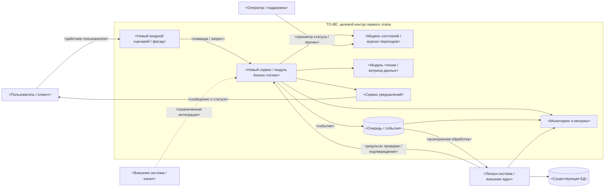

# transformation.md — описание трансформации и целевой архитектуры

> Назначение документа: описать, какие участки легаси-системы нужно изменить, почему именно они являются точками трансформации, как будет выглядеть целевая архитектура первого этапа и как проверить, что изменение действительно приблизило систему к цели.

## 0. Паспорт документа

| Поле | Значение |
|---|---|
| Название проекта | `<название проекта>` |
| Бизнес-сценарий | `<какой сценарий перепроектируется>` |
| Горизонт целевой архитектуры | `<первый релиз / пилот / этап миграции / целевое состояние>` |
| Автор | `<ФИО / роль>` |
| Дата | `<дата>` |
| Версия | `<версия>` |
| Связанные документы | `migration-roadmap.md`, `cutover-plan.md`, `<другие артефакты>` |

## 1. Краткое резюме трансформации

Опишите трансформацию в 5–7 предложениях: какая бизнес-цель стоит перед системой, что мешает достичь её в текущем состоянии, какие точки трансформации выбраны и каким будет целевое состояние первого этапа.

**Шаблон формулировки:**

> В рамках проекта `<название>` система должна поддержать сценарий `<сценарий>` и достичь эффекта `<бизнес-эффект>`. В текущем состоянии этому мешают `<ключевые препятствия AS-IS>`. Для первого этапа выбраны точки трансформации: `<точка 1>`, `<точка 2>`, `<точка 3>`. Целевая архитектура не заменяет всю легаси-систему сразу, а изолирует критичные зависимости, вводит `<новые компоненты / модели / контракты>` и позволяет проверить результат по метрикам `<метрики>`.

## 2. Бизнес-цель и критерии успеха

| Элемент | Описание |
|---|---|
| Бизнес-цель | `<какой деловой результат должен быть достигнут>` |
| Пользовательская ценность | `<что станет лучше для пользователя / клиента / оператора>` |
| Операционный эффект | `<что станет лучше для поддержки, эксплуатации, бизнеса>` |
| Горизонт проверки | `<когда можно понять, что изменение сработало>` |
| Ограничения результата | `<чего не обещаем в рамках первого этапа>` |

### 2.1. Метрики успеха

| Метрика | Базовое значение AS-IS | Целевое значение TO-BE | Источник данных | Частота контроля |
|---|---:|---:|---|---|
| `<метрика 1>` | `<значение>` | `<значение>` | `<система / отчёт / лог>` | `<частота>` |
| `<метрика 2>` | `<значение>` | `<значение>` | `<система / отчёт / лог>` | `<частота>` |
| `<метрика 3>` | `<значение>` | `<значение>` | `<система / отчёт / лог>` | `<частота>` |

## 3. Краткое описание AS-IS

Опишите только те элементы текущего состояния, которые важны для трансформации. Не нужно подробно описывать всю систему, если она не влияет на выбранный сценарий.

| Область | Текущее состояние | Почему это важно для трансформации |
|---|---|---|
| Бизнес-процесс | `<как сценарий работает сейчас>` | `<как влияет на цель>` |
| Компоненты | `<ключевые системы / сервисы / модули>` | `<где возникает ограничение>` |
| Данные | `<ключевые сущности, таблицы, статусы>` | `<где есть связность / рассинхронизация / неполнота>` |
| Интеграции | `<REST / очередь / файлы / общая БД / ручной обмен>` | `<какие зависимости создают>` |
| Эксплуатация | `<мониторинг, поддержка, ручные операции>` | `<какие риски или слепые зоны есть>` |

## 4. Ограничения и допущения

| Тип | Формулировка | Влияние на архитектуру |
|---|---|---|
| Техническое ограничение | `<что нельзя менять / чем нельзя управлять>` | `<какие решения исключает>` |
| Организационное ограничение | `<сроки, команды, владельцы, договорённости>` | `<как влияет на порядок работ>` |
| Инфраструктурное ограничение | `<ЦОД, облако, сеть, БД, брокер, лицензии>` | `<какие варианты недоступны>` |
| Доменное ограничение | `<правила предметной области>` | `<какие обещания пользователю нельзя давать>` |
| Допущение | `<что считаем верным до уточнения>` | `<как проверим>` |

## 5. Препятствия первого релиза

Зафиксируйте препятствия, которые мешают достичь бизнес-цели. Препятствие — это не обязательно точка трансформации. Если его нельзя изменить в текущем горизонте, оно становится ограничением или задачей будущего этапа.

| Препятствие | Где проявляется | Влияние на бизнес / пользователя | Можно изменить сейчас? | Решение |
|---|---|---|---|---|
| `<препятствие 1>` | `<процесс / компонент / данные>` | `<эффект>` | `<да / нет / частично>` | `<точка трансформации / ограничение / будущий этап>` |
| `<препятствие 2>` | `<процесс / компонент / данные>` | `<эффект>` | `<да / нет / частично>` | `<точка трансформации / ограничение / будущий этап>` |
| `<препятствие 3>` | `<процесс / компонент / данные>` | `<эффект>` | `<да / нет / частично>` | `<точка трансформации / ограничение / будущий этап>` |

## 6. Точки трансформации

Точка трансформации — это участок системы, процесса, данных или интеграций, текущее состояние которого мешает достижению бизнес-цели, но его можно изменить в рамках известных ограничений, а результат проверить метрикой.

| № | Точка трансформации | Проблема AS-IS | Целевое изменение | Ограничения | Метрика проверки | Владелец |
|---:|---|---|---|---|---|---|
| 1 | `<название>` | `<что мешает>` | `<что меняем>` | `<что учитываем>` | `<метрика>` | `<роль>` |
| 2 | `<название>` | `<что мешает>` | `<что меняем>` | `<что учитываем>` | `<метрика>` | `<роль>` |
| 3 | `<название>` | `<что мешает>` | `<что меняем>` | `<что учитываем>` | `<метрика>` | `<роль>` |

### 6.1. Паспорт точки трансформации

Скопируйте блок для каждой точки трансформации.

#### Точка трансформации: `<название>`

| Вопрос | Ответ |
|---|---|
| Какой бизнес-цели помогает? | `<ответ>` |
| Где находится в AS-IS? | `<процесс / компонент / данные / интеграция>` |
| Что именно плохо работает сейчас? | `<описание проблемы>` |
| Что изменится в TO-BE? | `<описание целевого изменения>` |
| Что не меняется на этом этапе? | `<границы изменения>` |
| Какие ограничения учитываются? | `<ограничения>` |
| Как проверяем результат? | `<метрики, наблюдения, критерии>` |
| Что будет считаться неуспехом? | `<условия остановки / пересмотра>` |

## 7. Матрица прослеживаемости изменений

Матрица нужна, чтобы показать цепочку: препятствие → бизнес-эффект → точка трансформации → архитектурное решение → метрика.

| Препятствие AS-IS | Бизнес-эффект, который нужно получить | Точка трансформации | Архитектурное решение | Метрика |
|---|---|---|---|---|
| `<препятствие>` | `<эффект>` | `<точка>` | `<решение>` | `<метрика>` |
| `<препятствие>` | `<эффект>` | `<точка>` | `<решение>` | `<метрика>` |
| `<препятствие>` | `<эффект>` | `<точка>` | `<решение>` | `<метрика>` |

## 8. Анализ связности

Связность показывает, какие части системы трудно менять отдельно. Чем выше связность, тем осторожнее нужно выбирать промежуточные состояния и порядок миграции.

| Вид связности | Где проявляется | Последствие | Как ослабляем в TO-BE |
|---|---|---|---|
| По данным | `<общие таблицы / справочники / статусы>` | `<что может сломаться>` | `<модель чтения / владение данными / контракты>` |
| По вызовам | `<синхронные вызовы / ожидание ответа>` | `<задержка / отказ сценария>` | `<очередь / асинхронность / таймауты>` |
| По развёртыванию | `<общий релиз / общий модуль>` | `<нельзя выпускать независимо>` | `<feature flag / отдельный сервис / контракт>` |
| По процессу | `<роли и шаги процесса>` | `<ручные обходы / зависимость подразделений>` | `<новые статусы / регламент / уведомления>` |

## 9. Транзакционные границы

Опишите, какие операции должны оставаться строго согласованными, а какие можно разделить на этапы с промежуточным статусом, событием или компенсирующим действием.

| Бизнес-операция | AS-IS граница | TO-BE граница | Тип согласованности | Компенсация / обработка ошибок |
|---|---|---|---|---|
| `<операция>` | `<как сейчас>` | `<как будет>` | `<строгая / eventual / ручная проверка>` | `<что делаем при ошибке>` |
| `<операция>` | `<как сейчас>` | `<как будет>` | `<строгая / eventual / ручная проверка>` | `<что делаем при ошибке>` |
| `<операция>` | `<как сейчас>` | `<как будет>` | `<строгая / eventual / ручная проверка>` | `<что делаем при ошибке>` |

## 10. Целевая архитектура первого этапа

Опишите TO-BE как реалистичное промежуточное состояние, а не как идеальную архитектуру «когда-нибудь». Целевое состояние первого этапа должно быть достижимо в рамках roadmap и проверяемо метриками.

### 10.1. Границы TO-BE

#### Входит в целевое состояние

- `<входит 1>`
- `<входит 2>`
- `<входит 3>`

#### Не входит в целевое состояние

- `<не входит 1>`
- `<не входит 2>`
- `<не входит 3>`

### 10.2. Компоненты TO-BE

| Компонент | Новый / существующий | Ответственность | Основные данные | Ключевые связи |
|---|---|---|---|---|
| `<компонент>` | `<новый / существующий>` | `<за что отвечает>` | `<данные>` | `<с кем связан>` |
| `<компонент>` | `<новый / существующий>` | `<за что отвечает>` | `<данные>` | `<с кем связан>` |
| `<компонент>` | `<новый / существующий>` | `<за что отвечает>` | `<данные>` | `<с кем связан>` |

### 10.3. Ключевые архитектурные решения

| № | Решение | Почему выбрано | Какие ограничения учитывает | Какие риски создаёт |
|---:|---|---|---|---|
| 1 | `<решение>` | `<обоснование>` | `<ограничения>` | `<риски>` |
| 2 | `<решение>` | `<обоснование>` | `<ограничения>` | `<риски>` |
| 3 | `<решение>` | `<обоснование>` | `<ограничения>` | `<риски>` |

## 11. Диаграмма TO-BE

Ниже приведена заготовка диаграммы TO-BE. Замените названия компонентов, внешних систем и потоков на данные своего кейса. Диаграмма должна показывать не все детали, а целевую логику первого этапа: какие компоненты появляются, какие зависимости изолируются, где проходят границы и как движутся ключевые данные.

### 11.1. Пояснение к диаграмме

| Элемент диаграммы | Что означает в кейсе | Почему важен для трансформации |
|---|---|---|
| `<элемент>` | `<пояснение>` | `<обоснование>` |
| `<элемент>` | `<пояснение>` | `<обоснование>` |
| `<элемент>` | `<пояснение>` | `<обоснование>` |

## 12. Разрывы между AS-IS и TO-BE

| Область | AS-IS | TO-BE | Разрыв | Как закрывается в roadmap |
|---|---|---|---|---|
| Процесс | `<как сейчас>` | `<как будет>` | `<что нужно изменить>` | `<этап roadmap>` |
| Данные | `<как сейчас>` | `<как будет>` | `<что нужно изменить>` | `<этап roadmap>` |
| Интеграции | `<как сейчас>` | `<как будет>` | `<что нужно изменить>` | `<этап roadmap>` |
| Наблюдаемость | `<как сейчас>` | `<как будет>` | `<что нужно изменить>` | `<этап roadmap>` |
| Эксплуатация | `<как сейчас>` | `<как будет>` | `<что нужно изменить>` | `<этап roadmap>` |

## 13. Риски и открытые вопросы

| Риск / вопрос | Тип | Влияние | Как проверяем / контролируем | Владелец | Срок уточнения |
|---|---|---|---|---|---|
| `<риск>` | `<технический / бизнес / операционный>` | `<влияние>` | `<контроль>` | `<роль>` | `<дата>` |
| `<вопрос>` | `<технический / бизнес / операционный>` | `<влияние>` | `<контроль>` | `<роль>` | `<дата>` |

## 14. Проверка качества документа

Перед сдачей проверьте, что:

- [ ] бизнес-цель сформулирована ясно и связана с архитектурными изменениями;
- [ ] AS-IS описан только в объёме, нужном для выбора точек трансформации;
- [ ] каждая точка трансформации отличается от обычной доработки и технического долга;
- [ ] для каждой точки трансформации есть метрика проверки;
- [ ] ограничения не спрятаны в тексте, а явно влияют на решения;
- [ ] TO-BE описывает достижимое состояние первого этапа;
- [ ] диаграмма TO-BE показывает границы, компоненты, легаси-зависимости и ключевые потоки;
- [ ] roadmap и cutover-plan могут быть построены на основе этого документа.
