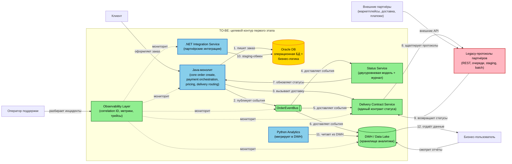

# transformation.md — описание трансформации и целевой архитектуры RetailCore

> Назначение документа: описать, какие участки легаси-системы нужно изменить, почему именно они являются точками трансформации, как будет выглядеть целевая архитектура первого этапа и как проверить, что изменение действительно приблизило систему к цели.

## 0. Паспорт документа

| Поле | Значение |
| -- | -- |
| Название проекта | RetailCore — трансформация платформы заказов |
| Бизнес-сценарий | Ускорение вывода коммерческих изменений при сохранении устойчивости order flow |
| Горизонт целевой архитектуры | Первый этап трансформации (6–9 месяцев) |
| Автор | Дмитрий |
| Дата | 2026-10-02 |
| Версия | 1.0 |
| Связанные документы | `requirements.md` (Task1), `as-is-analysis.md` (Task2), `architecture-canvas.md` (Task2) |

## 1. Краткое резюме трансформации

В рамках трансформации RetailCore система должна **ускорить вывод коммерческих изменений** (промо, партнёрские сценарии, новые каналы) и **повысить устойчивость критичного order flow**. В текущем состоянии этому мешают: **монолит со скрытой связностью, логика в Oracle-процедурах, отсутствие единого источника правды, размазанная модель статусов, аналитика, конкурирующая с операционным контуром**. Для первого этапа выбраны точки трансформации: **явная модель статусов, единый слой событий заказа, унификация контракта статуса доставки, изоляция аналитики от операционной БД, наблюдаемость критичного контура**. Целевая архитектура не заменяет всю легаси-систему сразу, а **добавляет слой событий, двухуровневую модель статусов и изолирует аналитику** — это позволяет проверить эффект по метрикам без риска для критичного контура.

## 2. Бизнес-цель и критерии успеха

| Элемент | Описание |
| -- | -- |
| Бизнес-цель | Сократить time-to-market коммерческих изменений и повысить устойчивость order flow в пиковые периоды |
| Пользовательская ценность | Клиент видит понятный статус заказа, точный срок доставки. Меньше отмен и противоречий |
| Операционный эффект | Поддержка получает единую картину заказа. Меньше ручных разборов, быстрее разбор инцидентов |
| Горизонт проверки | 6–9 месяцев (первый этап) |
| Ограничения результата | Не заменяем монолит целиком, не трогаем core order create и payment orchestration, не отказываемся от Oracle за один шаг |

### 2.1. Метрики успеха

| Метрика | Базовое значение AS-IS | Целевое значение TO-BE | Источник данных | Частота контроля |
| -- | --: | --: | -- | -- |
| Время от бизнес-идеи до запуска (time-to-market) | Не измеряется (GAP-02) | -30% (уточнить у Дмитрия) | Бизнес-трекинг | Ежеквартально |
| Доля расхождений между клиентским и внутренним статусом | ~15% (оценка из интервью) | <2% | Логи + BI | Еженедельно |
| Количество обращений в поддержку по статусу | Не измеряется (GAP-14) | -30% | CRM поддержки | Еженедельно |
| P95 подтверждения доставки | Не измеряется (GAP-08) | Уточнить у Сопровождения | Мониторинг | Ежедневно |
| Доля отчётов, читающих операционную Oracle напрямую | Большинство | <20% | Аудит аналитики | Ежемесячно |
| Время разбора инцидента | Часы (ручная работа) | -50% | Service Desk | Еженедельно |

**ПРИМЕЧАНИЕ**: Целевые значения надо уточнять, у нас пока нет таких точных данных, а в таблице для определенности указаны достаточно адекватные (и наверное обоснованные) значения.

## 3. Краткое описание AS-IS

> Описываются только те элементы текущего состояния, которые важны для трансформации, которые влияют на выбранный сценарий.

| Область | Текущее состояние | Почему это важно для трансформации |
| -- | -- | -- |
| Бизнес-процесс | Заказ проходит через монолит. Логика цены, промо, статусов, логистики размазана по коду, БД Oracle, конфигам | Непредсказуемость: любое изменение затрагивает несколько слоёв |
| Компоненты | Java-монолит (6 модулей) + БД Oracle + .NET сервис + Python сервис + Admin Tools | Монолит — центральный оркестратор. Oracle — общая БД, содержащая бизнес-логику, почти как ещё одно приложение |
| Данные | Операционная БД Oracle + staging и shared-таблицы + справочники + batch-коррекции | Нет канонической модели заказа, аналитика читает всё напрямую |
| Интеграции | REST + очереди + staging-таблицы + batch + polling | Нет единого стандарта, дедупликация и идемпотентность решаются по-разному в разных местах |
| Эксплуатация | Ручные вмешательства в статусы. Слабая наблюдаемость. "Племенные знания" | Разбор инцидентов это ручная работа, риск потери знаний |

## 4. Ограничения и допущения

| Тип | Формулировка | Влияние на архитектуру |
| -- | -- | -- |
| Техническое | Монолит нельзя заменить целиком. Не трогаем core order create и payment orchestration | Исключает big-bang redesign |
| Организационное | Команды (CRM, OMS, логистика, платежи) — жёсткие границы | Архитектура должна учитывать границы команд |
| Инфраструктурное | Инфраструктура on-premise. Oracle является критичной зависимостью. Виртуализация ограничена | Нельзя быстро масштабировать систему под нагрузку. Нужна постепенная миграция |
| Доменное | Один заказ в разных каналах проходит разные ветки логики | Нельзя унифицировать всё сразу |
| Доменное | Импортонезависимость это стратегическая цель, но не ценой остановки бизнеса | Нужен постепенный отказ от Oracle |
| Допущение | Поэтапное выделение модулей возможно без остановки | Если ложно, то пересмотр стратегии |
| Допущение | Знания о разборе статусов можно формализовать | Если ложно, то автоматизация будет неполной |

## 5. Препятствия первого релиза

> Препятствие, которые мешают достичь бизнес-цели, — это не обязательно точка трансформации. Если его нельзя изменить в текущем горизонте, оно становится ограничением или задачей будущего этапа.

| Препятствие | Где проявляется | Влияние на бизнес / пользователя | Можно изменить сейчас? | Решение |
| -- | -- | -- | -- | -- |
| Логика размазана по коду / Oracle / конфигам | Монолит (Pricing & Promo Logic, Status Management, Delivery Routing) | Изменения непредсказуемы. Долгий time-to-market | Частично | Точка трансформации 1, 2 |
| Модель статусов не соответствует реальности | Status Management + Payment Orchestration + batch + Admin Tools | Клиент видит противоречия, а поддержке тяжело разобраться и объяснить | Да | Точка трансформации 1 |
| Нет чистой модели событий заказа | Монолит — Oracle — аналитика | Аналитика догоняет реальность. Появляются разные цифры у бизнеса | Да | Точка трансформации 2 |
| Логистика это смесь REST + очереди + таблицы + batch | Delivery Routing + .NET Service + Async | Расхождение статусов доставки, дубли, ручной разбор | Частично | Точка трансформации 3 |
| Аналитика конкурирует с операционным контуром за БД Oracle | Python Analytics + BI-витрины — всё через Oracle | Деградация операционной БД на пиках | Да | Точка трансформации 4 |
| Слабая наблюдаемость | Затрагивает все компоненты | Разбор инцидентов это полностью ручная работа | Да | Точка трансформации 5 |
| Обмен через БД | Monolith — staging-слой в Oracle — .NET Service | Побочные эффекты при изменении | Частично | Не входит в первый этап (см. раздел 6) |
| Логика в Oracle-процедурах | Oracle | Блокирует вынос сервисов | Нет (слишком крупно) | Не входит в первый этап |
| On-premise на пределе | Инфраструктура | Долгое масштабирование | Нет (требует отдельной итерации проекта) | Не входит в первый этап |

## 6. Точки трансформации

> Точка трансформации — это участок системы, процесса, данных или интеграций, текущее состояние которого мешает достижению бизнес-цели, но его можно изменить в рамках известных ограничений, а результат проверить метрикой.

| ## | Точка трансформации | Проблема AS-IS | Целевое изменение | Ограничения | Метрика проверки | Владелец |
| -- | -- | -- | -- | -- | -- | -- |
| 1 | Явная модель статусов (двухуровневая + журнал) | Формальная модель не отражает реальность; логика размазана по 4 местам; клиент видит противоречия | Вводим двухуровневую модель (клиент vs внутренний) + журнал переходов **НО** не переписываем платёжный модуль и batch | Нельзя останавливать бизнес. Нельзя big-bang трансформацию | Доля расхождений (с ~15% до <2%). Количество обращений по статусу (-30%) | Head of Order Management |
| 2 | Единый слой событий заказа (канонический) | Нет чистой модели событий. Аналитика восстанавливает смысл ретроспективно, а бизнес получает разные цифры | Вводим слой OrderEvent + публикация в event bus. Аналитика читает и материализует состояние из событий **НО** монолит продолжает писать в Oracle, миграция аналитики идёт постепенно | Нельзя останавливать бизнес, аналитика не должна потерять данные | Время до формирования аналитики (минуты вместо часов). Доля расхождений (<1%). Доля отчётов на Oracle (<20%) | Tech Lead монолита + Senior Python Developer |
| 3 | Унификация контракта статуса доставки | Логистика это смесь REST + очереди + таблицы + batch. Нет единого контракта | Вводим единый контракт статуса доставки + унифицируем события **НО** не выносим логику выбора маршрута | Нельзя менять внешние API партнёров | P95 подтверждения доставки. Доля расхождений заказ/доставка | Senior Developer логистики |
| 4 | Изоляция аналитики от операционной БД (DWH) | Аналитика конкурирует с операционным контуром за БД Oracle | Выносим аналитику в DWH / Data Lake; операционная Oracle разгружается **НО** не выносим все отчёты сразу, мигрируем постепенно | Нельзя останавливать аналитику. Данные не должны потеряться | P95 операционных запросов. Нагрузка на Oracle | Senior Python Developer |
| 5 | Наблюдаемость критичного контура (correlation ID) | Слабая прослеживаемость, отсутствует correlation ID. Разбор инцидентов полностью вручную | Вводим сквозной correlation ID + метрики + трейсы **НО** не переписываем логирование всех сервисов сразу | Нельзя переписывать монолит, нужно встроить в существующее | Время разбора инцидента (-50%). Доля успешно прослеживаемых трейсов | Tech Lead монолита + Head of Support |

### 6.1. Паспорт точки трансформации #1

#### Точка трансформации: Явная модель статусов (двухуровневая + журнал)

| Вопрос | Ответ |
| -- | -- |
| Какой бизнес-цели помогает? | Прозрачность и предсказуемость order flow. Устраняет расхождение обещания и факта, что снижает обращения в поддержку |
| Где находится в AS-IS? | Модуль Status Management (Java-монолит), платёжный модуль, batch-процедуры, Admin Tools |
| Что именно плохо работает сейчас? | Формальная модель изменения статусов не отражает реальность: повторные оплаты, частичные отмены, перевыставление резерва, ручные восстановления, спец-статусы для партнёров. Логика переходов размазана по 4 местам. Поддержка не может объяснить клиенту состояние заказа |
| Что изменится в TO-BE? | Вводится двухуровневая модель: абстрактные статусы для клиента + детализированные технические для внутреннего контура. Журнал переходов (event log) с причиной и инициатором. Единая точка управления переходами |
| Что не меняется на этом этапе? | Внутренняя логика платёжного модуля и batch-процедур остаётся. Мы оборачиваем их в новый слой, но не переписываем |
| Какие ограничения учитываются? | Нельзя останавливать бизнес (CON-01). Нельзя в big-bang рефакторинг (CON-02). Организационная структура это жёсткая рамка (CON-06) |
| Как проверяем результат? | **Метрика 1**: доля расхождений между клиентским и внутренним статусом (AS-IS: ~15%, TO-BE: <2%). **Метрика 2**: количество обращений в поддержку по статусу (AS-IS: N/неделя, TO-BE: -30%). **Метрика 3**: доля ручных вмешательств в статусы (AS-IS: частая практика, TO-BE: <5%) |
| Что будет считаться неуспехом? | Если через 2 месяца после внедрения доля расхождений >5% или количество обращений не снизилось, потребуется пересмотр подхода |

### 6.2. Паспорт точки трансформации #2

#### Точка трансформации: Единый слой событий заказа (канонический)

| Вопрос | Ответ |
| -- | -- |
| Какой бизнес-цели помогает? | Прозрачность данных, единая картина для бизнеса. Устраняет расхождение цифр между маркетингом, операциями и финансами. Ускоряет аналитику |
| Где находится в AS-IS? | Монолит (Java), Oracle DB (текущая таблица заказа + история статусов + служебные таблицы + batch-коррекции). Аналитика (Python) читает всё это напрямую |
| Что именно плохо работает сейчас? | В монолите нет чистой модели событий, которую можно стримить. Аналитика восстанавливает смысл ретроспективно. Один заказ может выглядеть по-разному в разных витринах. Разные бизнес-функции получают разные цифры |
| Что изменится в TO-BE? | Вводится слой бизнес-событий заказа (OrderEvent): создан, подтверждён, оплачен, зарезервирован, отгружен, доставлен, отменён, возвращён. События публикуются в event bus (Kafka/RabbitMQ). Аналитика читает из событий, а не из операционной БД |
| Что не меняется на этом этапе? | Монолит продолжает писать в Oracle как раньше. Мы добавляем публикацию событий параллельно. Миграция аналитики на события выполняется постепенно |
| Какие ограничения учитываются? | Нельзя останавливать бизнес (CON-01). Нельзя в big-bang рефакторинг (CON-02). Аналитика не должна потерять данные на переходе (ASM-04) |
| Как проверяем результат? | **Метрика 1**: время от события до появления в аналитике (AS-IS: часы/дни, TO-BE: минуты). **Метрика 2**: доля расхождений между витринами (AS-IS: высокая, TO-BE: <1%). **Метрика 3**: количество отчётов, читающих операционную Oracle напрямую (AS-IS: большинство, TO-BE: <20%) |
| Что будет считаться неуспехом? | Если через 3 месяца после внедрения аналитика всё ещё читает операционную БД для >50% отчётов, то потребуется пересмотр подхода |

### 6.3. Паспорт точки трансформации #3

#### Точка трансформации: Унификация контракта статуса доставки

| Вопрос | Ответ |
| -- | -- |
| Какой бизнес-цели помогает? | Устойчивость order flow на стыке с логистикой. Снижение претензий клиентов по срокам доставки. Уменьшение ручных разборов рассинхрона заказ/доставка |
| Где находится в AS-IS? | Модуль Delivery Routing (Java-монолит), .NET Integration Service, Async / Batch Exchange (очереди, polling по таблицам, batch-задания), Oracle (справочники, staging-таблицы, региональные правила), внешние API логистических партнёров |
| Что именно плохо работает сейчас? | Каждый логистический партнёр подключён своим способом (синхронный REST, пачковая выгрузка, брокер, .NET-сервис через staging). Нет единого контракта статуса доставки. Семантика доставки сообщений разная (at-least-once где-то, polling по таблице где-то). Дедупликация и идемпотентность решаются по-разному, что приводит к дублям заявок у партнёров. Статус заказа и статус доставки расходятся, клиент видит меняющийся срок доставки — это один из частых источников претензий |
| Что изменится в TO-BE? | Вводится Delivery Contract Service — единый контракт статуса доставки для всех партнёров. Все обновления статусов доставки нормализуются через единый набор событий. Партнёрские адаптеры приводятся к единому интерфейсу: каждый адаптер переводит протокол конкретного партнёра в единый контракт. Единая идемпотентность и дедупликация на уровне контракта |
| Что не меняется на этом этапе? | Логика выбора маршрута доставки остаётся в монолите. Внешние API партнёров не меняются, вся адаптация происходит на нашей стороне. Обмен через staging-таблицы с .NET-сервисом не устраняется полностью, оборачивается в контракт |
| Какие ограничения учитываются? | Нельзя менять внешние API партнёров (CON-05). Нельзя останавливать бизнес (CON-01). Организационные границы команд логистики и монолита — жёсткая рамка (CON-06). Нельзя в big-bang трансформацию (CON-02) |
| Как проверяем результат? | **Метрика 1**: P95 подтверждения доставки (AS-IS: не измеряется; TO-BE: уточнить у Сопровождения). **Метрика 2**: доля расхождений между статусом заказа и статусом доставки (AS-IS: частая, TO-BE: < 3%). **Метрика 3**: количество ручных разборов дублей заявок у партнёров (AS-IS: периодически, TO-BE: <1 в неделю) |
| Что будет считаться неуспехом? | Если через 2 месяца после внедрения пилотного партнёра доля расхождений заказ/доставка не снизилась или количество дублей не уменьшилось, потребуется пересмотр контракта или подхода адаптера |

### 6.4. Паспорт точки трансформации #4

#### Точка трансформации: Изоляция аналитики от операционной БД (DWH)

| Вопрос | Ответ |
| -- | -- |
| Какой бизнес-цели помогает? | Устойчивость операционного контура в пиковые периоды. Снижение деградации Oracle от аналитических запросов. Управляемость данных, у бизнеса сходятся цифры |
| Где находится в AS-IS? | Python Analytics Jobs (прямые SQL в Oracle), BI-витрины (чтение напрямую из Oracle), Oracle DB (одновременно операционная БД и источник аналитики) |
| Что именно плохо работает сейчас? | Аналитика — набор разнородных пайплайнов (прямые SQL, выгрузки в staging, Python jobs через API, CSV от других систем), читающих операционную Oracle напрямую. В пиковые окна тяжёлые отчёты и исторические выборки конкурируют с операционным контуром за ресурсы. Аналитическая нагрузка деградирует производительность операционной БД. Нет канонической модели заказа, нет единого источника правды. Маркетинг, финансы и операционный блок получают разные цифры по одному процессу |
| Что изменится в TO-BE? | Вводится DWH / Data Lake, куда аналитика переносится. Источником данных для DWH становятся события из Order Event Bus (точка трансформации 2), а не прямые выборки из Oracle. Python Analytics мигрирует: пайплайны перестраиваются на чтение из DWH. Операционная Oracle разгружается от аналитических запросов. Миграция идёт постепенно, отчёты переносятся по приоритету |
| Что не меняется на этом этапе? | Не все отчёты переносятся сразу, часть можно оставить на Oracle до следующего этапа. Монолит продолжает писать в Oracle как раньше. Oracle-процедуры и пакеты с бизнес-логикой не выносятся. Staging-таблицы для .NET-сервиса остаются |
| Какие ограничения учитываются? | Нельзя останавливать аналитику (CON-01). Нельзя в big-bang рефакторинг (CON-02). Данные не должны потеряться на переходе (ASM-04). On-premise инфраструктура ограничена (GAP-18) |
| Как проверяем результат? | **Метрика 1**: доля отчётов, читающих операционную Oracle напрямую (AS-IS: большинство, TO-BE: <20%). **Метрика 2**: P95 latency операционных запросов в пиковые окна (AS-IS: деградация на пиках, TO-BE: снижение деградации на 30+%). **Метрика 3**: нагрузка на Oracle от аналитических запросов (AS-IS: высокая, TO-BE: <20% от общего объёма) |
| Что будет считаться неуспехом? | Если через 3 месяца после запуска DWH операционная Oracle всё ещё испытывает деградацию от аналитических запросов, или если бизнес сообщает о потере данных при миграции, потребуется пересмотр подхода к загрузке DWH |

### 6.5. Паспорт точки трансформации #5

#### Точка трансформации: Наблюдаемость критичного контура (correlation ID)

| Вопрос | Ответ |
| -- | -- |
| Какой бизнес-цели помогает? | Снижение времени разбора инцидентов. Прозрачность критичного order flow для поддержки и разработки. Основа для автоматизации выявления "зависших" статусов |
| Где находится в AS-IS? | Java-монолит (логи без сквозных correlation ID), .NET Integration Service (отдельные логи), Python Analytics (отдельные логи), Oracle (журналы БД), Admin Tools (ручные действия операторов) |
| Что именно плохо работает сейчас? | Логи есть, но корреляционные идентификаторы есть не везде. Если заказ прошёл через монолит, .NET-модуль и Python-аналитику, восстановление истории — почти ручная работа. Поддержка не может быстро собрать полную цепочку заказа. "Племенные знания" команды это единственный способ разобраться в инциденте. Нет карты причинно-следственных связей (почему промо долго, где тормозит Oracle) |
| Что изменится в TO-BE? | Вводится сквозной correlation ID, который прокидывается через все компоненты контура заказа: монолит, .NET-сервис, event bus, DWH, Admin Tools. Корреляция применяется к существующим логам без переписывания монолита, ID добавляется в точках входа и передаётся далее. Вводятся базовые метрики по критичному контуру: время прохождения ключевых этапов, доля успешных трейсов, алерты на "зависшие" цепочки. Вырабатываем стандартный формат лог-записи с correlation ID, timestamp, типом события, ID заказа |
| Что не меняется на этом этапе? | Монолит не переписывается, correlation ID встраивается в существующие точки входа. Полная переработка логирования всех сервисов не выполняется. Distributed tracing (типа OpenTelemetry) вводится ограниченно, для критичного контура, а не для всех систем |
| Какие ограничения учитываются? | Нельзя переписывать монолит (CON-02). Нельзя останавливать бизнес (CON-01). Команды работают в своих границах (CON-06). Существующие legacy-системы должны генерировать события/логи (ASM-04) |
| Как проверяем результат? | **Метрика 1**: время разбора инцидента (AS-IS: часы, ручная работа, TO-BE: -50%). **Метрика 2**: доля заказов, по которым можно автоматически собрать полную цепочку (AS-IS: низкая, TO-BE: >80%). **Метрика 3**: количество инцидентов, разобранных без обращения к "племенным знаниям" команды (AS-IS: большинство требует людей, TO-BE: <30%) |
| Что будет считаться неуспехом? | Если через 2 месяца после внедрения correlation ID время разбора инцидентов не сократилось или доля автоматически собираемых трейсов <50%, потребуется пересмотр покрытия или формата логирования |

## 7. Матрица прослеживаемости изменений

> Матрица нужна, чтобы показать цепочку: препятствие → бизнес-эффект → точка трансформации → архитектурное решение → метрика.

| Препятствие AS-IS | Бизнес-эффект, который нужно получить | Точка трансформации | Архитектурное решение | Метрика |
| -- | -- | -- | -- | -- |
| Модель статусов не соответствует реальности | Уменьшение обращений в поддержку. Клиент видит соответствующие и понятные статусы | 1 | Двухуровневая модель + журнал | Доля расхождений |
| Нет чистой модели событий заказа | Ускорение аналитики. У бизнеса сходятся цифры из разных срезов аналитики | 2 | Канонический слой OrderEvent + event bus | Время до аналитики |
| Логистика это смесь протоколов | Уменьшение количества претензий, связанных с логистикой. Сроки доставки меняются только по объективным причинам | 3 | Единый контракт статуса доставки | P95 подтверждения |
| Аналитика конкурирует с операционным контуром | Снижение деградации операционная БД под нагрузкой (от аналитических запросов) | 4 | DWH / Data Lake | P95 latency операционных запросов |
| Слабая наблюдаемость | Ускорение выполнения ручного разбора инцидентов | 5 | Correlation ID + метрики + трейсы | Время разбора инцидента |

## 8. Анализ связности

> Связность показывает, какие части системы трудно менять отдельно. Чем выше связность, тем осторожнее нужно выбирать промежуточные состояния и порядок миграции.

| Вид связности | Где проявляется | Последствие | Как ослабляем в TO-BE |
| -- | -- | -- | -- |
| По данным | Общая Oracle для операционного контура и аналитики | Изменение схемы ломает аналитику | DWH изолирует аналитику (точка 4) |
| По данным | Staging-таблицы (.NET Service и Oracle) | Побочные эффекты при изменении | Не входит в первый этап трансформации |
| По вызовам | Синхронные вызовы платежей и логистики в транзакции | Длинные транзакции, деградация производительности | Не входит в первый этап трансформации (не трогаем core order create) |
| По развёртыванию | Монолит это единый релиз | Нельзя выпускать независимо | Не входит в первый этап трансформации |
| По процессу | Статусы размазаны по 4 местам | Ручные вмешательства | Двухуровневая модель + журнал (точка 1) |
| По процессу | Логистика состоит из разных протоколов | Ручной разбор | Единый контракт (точка 3) |

## 9. Транзакционные границы

> Какие операции должны оставаться строго согласованными, а какие можно разделить на этапы с промежуточным статусом, событием или компенсирующим действием.

| Бизнес-операция | AS-IS граница | TO-BE граница | Тип согласованности | Компенсация / обработка ошибок |
| -- | -- | -- | -- | -- |
| Создание заказа | Строгая (в монолите) | Остаётся строгой (не трогаем) | Строгая | — |
| Обновление статуса | Размазана по 4 местам | Единая точка + журнал | Строгая для внутреннего, eventual для клиентского | Retry + dead letter queue |
| Резервирование доставки | Синхронно (в транзакции) | Остаётся (не трогаем) | Строгая | — |
| Публикация события заказа | Отсутствует | Очередь/брокер (at-least-once) | Eventual | Идемпотентность + дедупликация |
| Обновление аналитики | Прямой SQL (sync) | Из событий | Eventual | Replay из event bus |
| Уведомление клиента | Нет | По событиям | Eventual | Retry + журнал доставки |

## 10. Целевая архитектура первого этапа

> Описать TO-BE как реалистичное промежуточное состояние, а не как идеальную архитектуру «когда-нибудь». Целевое состояние первого этапа должно быть достижимо в рамках roadmap и проверяемо метриками.

### 10.1. Границы TO-BE

#### Входит в целевое состояние

- Двухуровневая модель статусов + журнал переходов
- Слой событий заказа (OrderEvent) + event bus
- Единый контракт статуса доставки
- DWH / Data Lake для аналитики
- Correlation ID + метрики + трейсы

#### Не входит в целевое состояние

- Замена монолита
- Вынос core order create и payment orchestration
- Отказ от Oracle
- Устранение обмена через БД
- Вынос логики выбора маршрута доставки

### 10.2. Компоненты TO-BE

| Компонент | Новый / существующий | Ответственность | Основные данные | Ключевые связи |
| -- | -- | -- | -- | -- |
| Java-монолит | Существующий | Core order create, payment orchestration, pricing, delivery routing | Заказ, платёж, доставка | Oracle, event bus, внешние сервисы |
| Oracle DB | Существующий | Операционная БД + бизнес-логика | Заказы, справочники, staging | Монолит, .NET Service |
| .NET Integration Service | Существующий | Партнёрские интеграции | staging-данные | Oracle, delivery |
| Python Analytics | Существующий (мигрирует) | Аналитические пайплайны | DWH, витрины | DWH, BI |
| Status Service | Новый | Двухуровневая модель статусов + журнал | Статусы, переходы | Монолит, event bus |
| Order Event Bus | Новый | Публикация и доставка событий заказа | События заказа | Монолит, Status Service, Delivery Contract Service, DWH |
| Delivery Contract Service | Новый | Единый контракт статуса доставки | Статусы доставки | Delivery Routing, партнёры, event bus |
| DWH / Data Lake | Новый | Хранилище аналитики | События, витрины | Event bus, BI, аналитика |
| Observability Layer (это не компонент, это слой) | Новый | Correlation ID + метрики + трейсы | Трейсы, метрики, логи | Все компоненты |

### 10.3. Ключевые архитектурные решения

| ## | Решение | Почему выбрано | Какие ограничения учитывает | Какие риски создаёт |
| -- | -- | -- | -- | -- |
| 1 | Event-driven слой (OrderEvent + event bus) | Ослабляет связность, даёт канонический источник | Не трогать монолит, будет работать параллельно | Дубли событий, рассинхрон, тракт через монолит может запаздывать |
| 2 | Двухуровневая модель статусов | Решает проблему расхождений | Не переписывать платёжный модуль | Неверный маппинг |
| 3 | DWH для аналитики | Изолирует аналитику от операционного контура | Постепенная миграция | Рассинхрон DWH и Oracle |
| 4 | Единый контракт статуса доставки | Устраняет разнородность протоколов (изолирует систем от протоколов партнеров) | Не трогает внешние API | Сложность унификации |
| 5 | Correlation ID | Улучшает наблюдаемость | Не переписывать монолит | Сложность встраивания |

## 11. Диаграмма TO-BE

Ниже приведена верхнеуровневая диаграмма целевой архитектуры первого этапа. Она показывает, какие компоненты появляются, какие зависимости изолируются, где проходят границы целевого контура и как движутся ключевые данные.

Детальная C4-диаграмма представлена отдельным артефактом: `to-be.drawio`.

### 11.1. Пояснение к диаграмме

| Элемент диаграммы | Что означает в кейсе | Почему важен для трансформации |
| -- | -- | -- |
| `<элемент>` | `<пояснение>` | `<обоснование>` |
| Клиент | Конечный пользователь, оформляет заказы | Источник требований к прозрачности статусов |
| Оператор поддержки | Разбирает инциденты, работает с зависшими заказами | Основной потребитель наблюдаемости (точка 5) |
| Бизнес-пользователь | Смотрит отчёты, принимает решения | Потребитель единой картины данных (точки 2, 4) |
| Java-монолит | Core order create, payment orchestration, pricing, delivery routing | Остаётся без изменений (рекомендация Tech Lead) |
| Oracle DB | Операционная БД + бизнес-логика + staging | Остаётся, но разгружается от аналитики (точка 4) |
| .NET Integration Service | Существующий: партнёрские интеграции через staging | Остаётся (не входит в первый этап) |
| Python Analytics | Существующий: мигрирует в DWH | Мигрирует в рамках точки 4 |
| Legacy-протоколы партнёров | REST, очереди, staging, batch | Остаются, но оборачиваются в контракт (точка 3) |
| Внешние партнёры | Маркетплейсы, доставка, платежи | Не меняются (CON-05) |
| Status Service | Новый компонент: двухуровневая модель + журнал переходов | Точка 1. Решает проблему расхождений статусов |
| Order Event Bus | Новый компонент: слой событий заказа | Точка 2. Фундамент для событийной архитектуры |
| Delivery Contract Service | Новый компонент: единый контракт статуса доставки | Точка 3. Устраняет разнородность протоколов |
| DWH / Data Lake | Новый компонент: хранилище аналитики | Точка 4. Изолирует аналитику от операционной БД |
| Observability Layer | Новый слой: correlation ID, метрики, трейсы | Точка 5. Ускоряет разбор инцидентов |

## 11.2. Ключевые потоки данных

| ## | Поток | Что происходит | Связанная точка трансформации |
| -- | -- | -- | -- |
| 1 | Monolith — Oracle | Монолит пишет заказ как раньше | — |
| 2 | Monolith — Event Bus | Монолит публикует события заказа | 2 |
| 3 | Monolith — Delivery Contract | Монолит вызывает доставку | 3 |
| 4 | Event Bus — Status Service | События обновляют статусы | 1, 2 |
| 5 | Event Bus — Delivery Contract | События унифицируют статусы доставки | 2, 3 |
| 6 | Event Bus — DWH | События наполняют аналитику | 2, 4 |
| 7 | Status Service — Monolith | Единая точка управления статусами | 1 |
| 8 | Delivery Contract — Legacy | Адаптация протоколов партнёров | 3 |
| 9 | Legacy — Delivery Contract | Обратные статусы от партнёров | 3 |
| 10 | .NET Service — Oracle | Staging-обмен (не трогаем) | — |
| 11 | Python Analytics — DWH | Аналитика читает из DWH | 4 |
| 12 | DWH — Business | Бизнес видит единую картину | 2, 4 |

## 12. Разрывы между AS-IS и TO-BE

| Область | AS-IS | TO-BE | Разрыв | Как закрывается в roadmap |
| -- | -- | -- | -- | -- |
| Процесс | Статусы размазаны по 4 местам | Единая точка + журнал | Нужна миграция логики | Точка 1 |
| Данные | Прямой SQL в Oracle | Канонические события + DWH | Нужен event bus + DWH | Точки 2, 4 |
| Интеграции | Смесь REST + очереди + таблицы + batch | Единый контракт для работы с доставкой | Нужна унификация | Точка 3 |
| Наблюдаемость | Слабая, нет correlation ID | Сквозной correlation ID + метрики | Нужно встроить в legacy | Точка 5 |
| Эксплуатация | Ручные вмешательства | Автоматизация + наблюдаемость | Постепенная миграция | Точки 1, 5 |

## 13. Риски и открытые вопросы

| Риск / вопрос | Тип | Влияние | Как проверяем / контролируем | Владелец | Срок уточнения |
| -- | -- | -- | -- | -- | -- |
| `<риск>` | `<технический / бизнес / операционный>` | `<влияние>` | `<контроль>` | `<роль>` | `<дата>` |
| Дубли событий в event bus | Технический | Рассинхрон данных | Идемпотентность + дедупликация | Tech Lead | До реализации |
| Неверный маппинг статусов | Технический | Расхождения для клиента | Пилот на 5 магазинах | Head of Order Management | До реализации |
| Сопротивление команд | Операционный | Замедление трансформации | Опираться на согласованную картину | Director of Digital Commerce | Постоянно |
| Рассинхрон DWH и Oracle | Технический | Разные цифры у бизнеса | Replay из event bus | Senior Python Developer | До реализации |
| Сложность унификации доставки | Технический | Задержка точки 3 | Пилот с одним партнёром | Senior Developer логистики | До реализации |
| Нет целевых метрик (GAP-02) | Бизнес | Нельзя измерить эффект | Уточнить у бизнеса-заказчика | Director of Digital Commerce | До реализации |
| Нет SLA/SLO (GAP-20) | Технический | Нельзя измерить надёжность | Уточнить у Сопровождения | Сопровождение | До реализации |

## 14. Проверка качества документа

- [x] бизнес-цель связана с архитектурными изменениями;
- [x] AS-IS описан только в объёме, нужном для выбора точек;
- [x] каждая точка трансформации отличается от обычной доработки;
- [x] для каждой точки трансформации есть метрика проверки;
- [x] ограничения явно влияют на решения;
- [x] TO-BE описывает достижимое состояние первого этапа;
- [x] диаграмма TO-BE показывает границы, компоненты и ключевые потоки;
- [x] roadmap и cutover-plan могут быть построены на основе этого документа.
