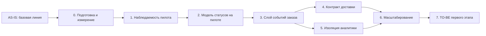

# migration-roadmap.md — roadmap инкрементальной миграции RetailCore

> Назначение документа: показать безопасный путь от AS-IS к TO-BE через промежуточные состояния, зависимости, риски, условия остановки и критерии завершения этапов.

## 0. Паспорт roadmap

| Поле | Значение |
| -- | -- |
| Название проекта | RetailCore — трансформация платформы заказов |
| Связанный документ трансформации | `transformation.md` (Task3) |
| Горизонт планирования | Первый этап (6–9 месяцев) + масштабирование |
| Выбранная стратегия миграции | **Incremental Migration** + элементы **Parallel Run** |
| Ключевые паттерны | **Strangler Fig**, **Anti-Corruption Layer**, **Event-Driven Architecture** |
| Автор | Дмитрий |
| Дата | 2026-10-08 |
| Версия | 1.0 |

## 1. Краткое резюме roadmap

Миграция выполняется инкрементально, потому что **нельзя останавливать бизнес (CON-01)** и **нельзя делать big-bang (CON-02) трансформацию**. Сначала команда **собирает базовые метрики и определяет границы пилота** (этап 0), затем **включает наблюдаемость критичного контура** (этап 1) — без неё нельзя измерить эффект. После этого **вводится двухуровневая модель статусов** (этап 2), на её основе создается **канонический слой событий заказа** (этап 3). Затем параллельно запускаются **контракт статуса доставки** (этап 4) и **DWH для аналитики** (этап 5), потому что оба зависят от событий, но независимы друг от друга. После стабилизации пилота выполняется **масштабирование на все магазины** (этап 6) и **проверка целевых метрик** (этап 7). Такой порядок выбран из-за зависимостей: наблюдаемость — статусы — события — доставка + аналитика. Основные риски roadmap связаны с **дублями событий, неверным маппингом статусов и рассинхроном DWH**, поэтому для каждого этапа заданы критерии готовности и условия остановки.

## 2. Стартовое и целевое состояние

| Состояние | Описание | Ключевые ограничения | Метрики / признаки состояния |
| -- | -- | -- | -- |
| AS-IS | Монолит + Oracle + .NET + Python. Логика размазана, статусы не соответствуют реальности, аналитика конкурирует с операционным контуром | CON-01 .. CON-06 | Time-to-market не измеряется. Доля расхождений статусов ~15% |
| Промежуточное 1 (после этапа 1) | Наблюдаемость включена на 5 пилотных магазинах. Собираются базовые метрики | Монолит не тронут | Correlation ID покрывает критичный контур пилота |
| Промежуточное 2 (после этапа 2) | Двухуровневая модель статусов на пилоте и журнал переходов | Платёжный модуль и batch не переписываются | Доля расхождений <5% на пилоте |
| Промежуточное 3 (после этапа 3) | События публикуются из монолита. Аналитика читает данные из событий | Oracle продолжает работать | Время до получения аналитики сокращается до минут |
| TO-BE первого этапа (после этапа 7) | 5 точек трансформации внедрены на всех магазинах. Целевые метрики достигнуты | Legacy не тронут (core order create, payment orchestration, staging-обмен, Oracle-процедуры) | Целевые метрики из transformation.md |

## 3. Принципы построения roadmap

> Зафиксированы правила, по которым выстроен порядок этапов.

- **Сначала измеряем, потом меняем:** базовые метрики (P95, доля расхождений) собираются на этапе 0, до любых изменений
- **Сначала изолируем риск, потом расширяем сценарий:** пилот на 5 магазинах, не на всей сети
- **Сначала управляемый пилот, потом масштабирование:** этапы 1-5 на пилоте, этап 6 — масштабирование
- **Сначала модель состояний, потом коммуникация:** сначала обеспечить точку трансформации 1 (статусы) и только потом переходить к точке 2 (события)
- **Сначала наблюдаемость, потом изменения:** точка трансформации 5 (наблюдаемость) находится первая в roadmap, потому что без неё нельзя измерить эффект
- **Сначала события, потом потребители:** точка трансформации 2 (события) должна быть достигнута перед точками 3, 4 (доставка, аналитика)

## 4. Roadmap миграции

| Этап | Цель | Промежуточное состояние | Основные работы | Зависимости | Риски | Критерии завершения |
| -- | -- | -- | -- | -- | -- | -- |
| AS-IS | Зафиксировать стартовую точку | Текущая архитектура | Описать AS-IS, собрать baseline | — | Неполные данные | Baseline подтверждён |
| 0. Подготовка и измерение | Собрать базовые метрики, определить границы пилота | Метрики собраны, пилот определён | Измерить P95, долю расхождений, время разбора. Определить 5 магазинов пилота | AS-IS | Нет данных для baseline | Метрики согласованы, пилот определён |
| 1. Наблюдаемость пилота | Включить correlation ID на 5 магазинах | Correlation ID покрывает критичный контур пилота | Внедрить correlation ID, метрики, трейсы | Этап 0 | Сложность встраивания в legacy | Correlation ID покрывает >80% заказов на пилоте |
| 2. Модель статусов на пилоте | Двухуровневая модель + журнал на пилоте | Статусы на пилоте единые; журнал переходов | Внедрить Status Service; обернуть legacy-статусы через ACL; журнал переходов | Этап 1 | Неверный маппинг статусов | Доля расхождений <5% на пилоте |
| 3. Слой событий заказа | OrderEvent + event bus на пилоте | Монолит публикует события параллельно с Oracle | Внедрить Order Event Bus; публикация событий из монолита; consumer для аналитики | Этап 2 | Дубли событий; рассинхрон | Время до аналитики — минуты; дублей <0.1% |
| 4. Контракт статуса доставки | Единый контракт для партнёров на пилоте | Партнёры работают через единый контракт | Внедрить Delivery Contract Service; адаптеры для партнёров; идемпотентность | Этап 3 | Сложность унификации; сопротивление команд | P95 подтверждения; дублей <1/неделя |
| 5. Изоляция аналитики | DWH для аналитики на пилоте | Аналитика читает из DWH, а не из Oracle | Внедрить DWH; мигрировать отчёты пилота; постепенно расширять | Этап 3 | Рассинхрон DWH и Oracle | Доля отчётов на Oracle <20% на пилоте |
| 6. Масштабирование | Расширение на все магазины | Все 5 точек внедрены на всех магазинах | Расширять пилот до всей сети; стабилизировать метрики | Этапы 1-5 | Масштабирование выявляет новые риски | Целевые метрики достигнуты на всей сети |
| TO-BE первого этапа | Проверить целевые метрики | Целевое состояние достигнуто | Финальные проверки; аудит метрик | Этап 6 | Остаточные риски | Все целевые метрики достигнуты |

## 5. Детализация этапов

### Этап 0: Подготовка и измерение

| Раздел | Содержание |
| -- | -- |
| Цель этапа | Собрать базовые метрики, определить границы пилота |
| Какие точки трансформации закрывает | Никакие (подготовительный этап) |
| Что меняется в процессе | Ничего (только измерение) |
| Что меняется в архитектуре | Ничего |
| Что не меняется | Всё остаётся как есть |
| Входные условия | AS-IS описан (Task2) |
| Выходные условия | Метрики собраны, пилот определён (5 магазинов) |
| Метрики этапа | P95, доля расхождений, время разбора инцидента |
| Риски этапа | Нет данных для baseline |
| Условие остановки | Baseline невозможно подтвердить |

### Этап 1: Наблюдаемость пилота

| Раздел | Содержание |
| -- | -- |
| Цель этапа | Включить correlation ID на 5 пилотных магазинах |
| Какие точки трансформации закрывает | Точка 5 (наблюдаемость) |
| Что меняется в процессе | Разбор инцидентов становится быстрее |
| Что меняется в архитектуре | Добавляется Observability Layer (correlation ID, метрики, трейсы) |
| Что не меняется | Монолит не переписывается; core order create не трогаем |
| Входные условия | Этап 0 завершён; пилот определён |
| Выходные условия | Correlation ID покрывает >80% заказов на пилоте |
| Метрики этапа | Доля трейсов >80%; время разбора инцидента -50% |
| Риски этапа | Сложность встраивания в legacy |
| Условие остановки | Correlation ID не покрывает >50% заказов |

### Этап 2: Модель статусов на пилоте

| Раздел | Содержание |
| -- | -- |
| Цель этапа | Внедрить двухуровневую модель статусов на пилоте |
| Какие точки трансформации закрывает | Точка 1 (статусы) |
| Что меняется в процессе | Клиент видит понятные статусы; поддержка видит детализированные |
| Что меняется в архитектуре | Добавляется Status Service (ACL над legacy-статусами) |
| Что не меняется | Платёжный модуль и batch не переписаны |
| Входные условия | Этап 1 завершён (наблюдаемость нужна для проверки) |
| Выходные условия | Доля расхождений <5% на пилоте |
| Метрики этапа | Доля расхождений; количество обращений по статусу |
| Риски этапа | Неверный маппинг статусов |
| Условие остановки | Доля расхождений >10% |

### Этап 3: Слой событий заказа на пилоте

| Раздел | Содержание |
| -- | -- |
| Цель этапа | Внедрить Order Event Bus, публикация событий из монолита |
| Какие точки трансформации закрывает | Точка 2 (события) |
| Что меняется в процессе | Аналитика получает данные быстрее |
| Что меняется в архитектуре | Добавляется Order Event Bus + публикация OrderEvent |
| Что не меняется | Oracle продолжает работать; монолит не переписывается |
| Входные условия | Этап 2 завершён (события строятся на модели статусов) |
| Выходные условия | Время до аналитики — минуты; дублей <0.1% |
| Метрики этапа | Время до аналитики; доля дублей |
| Риски этапа | Дубли событий; рассинхрон |
| Условие остановки | Дубли >1% |

### Этап 4: Контракт статуса доставки на пилоте

| Раздел | Содержание |
| -- | -- |
| Цель этапа | Единый контракт статуса доставки для партнёров |
| Какие точки трансформации закрывает | Точка 3 (доставка) |
| Что меняется в процессе | Меньше претензий по срокам доставки |
| Что меняется в архитектуре | Добавляется Delivery Contract Service |
| Что не меняется | Логика выбора маршрута остаётся в монолите |
| Входные условия | Этап 3 завершён (события поступают из event bus) |
| Выходные условия | P95 подтверждения; дублей <1/неделя |
| Метрики этапа | P95 подтверждения; доля дублей |
| Риски этапа | Сложность унификации; сопротивление команд |
| Условие остановки | Дубли >5/неделя |

### Этап 5: Изоляция аналитики на пилоте

| Раздел | Содержание |
| -- | -- |
| Цель этапа | DWH для аналитики |
| Какие точки трансформации закрывает | Точка 4 (DWH) |
| Что меняется в процессе | Операционная Oracle разгружается |
| Что меняется в архитектуре | Добавляется DWH / Data Lake |
| Что не меняется | Не все отчёты переносятся сразу |
| Входные условия | Этап 3 завершён (события поступают из event bus) |
| Выходные условия | Доля отчётов на Oracle <20% на пилоте |
| Метрики этапа | P95 операционных запросов; нагрузка на Oracle |
| Риски этапа | Рассинхрон DWH и Oracle |
| Условие остановки | Рассинхрон >5% |

### Этап 6: Масштабирование

| Раздел | Содержание |
| -- | -- |
| Цель этапа | Расширить пилот на все магазины |
| Какие точки трансформации закрывает | Все 5 точек |
| Что меняется в процессе | Все магазины получают новые возможности |
| Что меняется в архитектуре | Не меняется (масштабирование) |
| Что не меняется | Legacy не трогаем |
| Входные условия | Этапы 1-5 стабильны на пилоте |
| Выходные условия | Целевые метрики на всей сети |
| Метрики этапа | Целевые метрики из `transformation.md` |
| Риски этапа | Масштабирование выявляет новые риски |
| Условие остановки | Метрики ухудшаются на >10% |

### Этап 7: TO-BE первого этапа

| Раздел | Содержание |
| -- | -- |
| Цель этапа | Проверка достижения целевых метрик |
| Какие точки трансформации закрывает | Никакие (проверка) |
| Что меняется в процессе | Ничего |
| Что меняется в архитектуре | Ничего |
| Что не меняется | Всё остаётся как есть |
| Входные условия | Этап 6 завершён |
| Выходные условия | Все целевые метрики достигнуты |
| Метрики этапа | Все метрики из `transformation.md` |
| Риски этапа | Остаточные риски |
| Условие остановки | Метрики не достигнуты |

## 6. Зависимости между этапами

### 6.1. Таблица зависимостей

| Зависимость | Почему порядок жёсткий | Что будет, если нарушить порядок | Как контролируем |
| -- | -- | -- | -- |
| Этап 1 до Этапа 2 | Без наблюдаемости нельзя измерить эффект статусов | Нельзя понять, стало ли лучше | Метрики Этапа 1 |
| Этап 2 до Этапа 3 | События строятся на модели статусов | События будут неточными | Метрики Этапа 2 |
| Этап 3 до Этапов 4, 5 | Доставка и аналитика зависят от событий | Нет источника данных | Метрики Этапа 3 |
| Этапы 4, 5 можно параллельно | Оба зависят от событий, но независимы | Нужно синхронизировать масштабирование | Координация команд |
| Этапы 1-5 до Этапа 6 | Масштабирование только после стабилизации пилота | Масштабирование выявит непредвиденные риски | Метрики пилота |

## 7. Управление рисками roadmap

> Риск должен быть встроен в этап, а не вынесен только в конец документа. Для каждого риска указывается контроль и условие остановки.

| Этап | Риск | Вероятность | Влияние | Контроль | Условие остановки | Владелец |
| -- | -- | -- | -- | -- | -- | -- |
| 0 | Нет данных для baseline | Средняя | Высокое | Сверка источников | Baseline невозможно подтвердить | Сопровождение |
| 1 | Сложность встраивания в legacy | Средняя | Среднее | Пилот на 5 магазинах | Correlation ID не покрывает >50% | Tech Lead |
| 2 | Неверный маппинг статусов | Средняя | Высокое | Пилот, ручная проверка | Доля расхождений >10% | Head of Order Management |
| 3 | Дубли событий | Высокая | Среднее | Идемпотентность + дедупликация | Дубли >1% | Tech Lead |
| 4 | Сложность унификации доставки | Высокая | Среднее | Пилот с одним партнёром | Дубли >5/неделя | Senior Developer логистики |
| 5 | Рассинхрон DWH и Oracle | Средняя | Высокое | Replay из event bus | Рассинхрон >5% | Senior Python Developer |
| 6 | Масштабирование выявляет новые риски | Высокая | Высокое | Постепенное расширение | Метрики ухудшаются >10% | Бизнес-заказчик |
| 7 | Остаточные риски | Средняя | Среднее | Аудит метрик | Метрики не достигнуты | Бизнес-заказчик |

## 8. Метрики и контрольные точки

| Контрольная точка | Когда проверяем | Что проверяем | Целевой порог | Источник данных | Решение по результату |
| -- | -- | -- | -- | -- | -- |
| После этапа 0 | Через 1 неделю | Baseline метрик | Все метрики собраны | Логи, BI | Продолжить / уточнить |
| После этапа 1 | Через 2 недели | Покрытие correlation ID | >80% | Мониторинг | Продолжить / откатить |
| После этапа 2 | Через 4 недели | Доля расхождений статусов | <5% | Логи + BI | Продолжить / откатить |
| После этапа 3 | Через 6 недель | Время до аналитики | Минуты | Мониторинг | Продолжить / откатить |
| После этапа 4 | Через 8 недель | P95 подтверждения доставки | Согласовано | Мониторинг | Продолжить / откатить |
| После этапа 5 | Через 10 недель | Доля отчётов на Oracle | <20% | Аудит аналитики | Продолжить / откатить |
| После этапа 6 | Через 16 недель | Все целевые метрики | Из `transformation.md` | Все источники | Продолжить / остановить |

## 9. Промежуточные состояния

> Промежуточное состояние должно быть работоспособным. Нельзя планировать этап, после которого система находится в неопределённом или неподдерживаемом виде.

| Промежуточное состояние | Что уже работает | Что ещё остаётся в легаси | Как пользователь видит сценарий | Как поддержка видит сценарий | Основные риски |
| -- | -- | -- | -- | -- | -- |
| После этапа 1 | Наблюдаемость на пилоте | Всё остальное | Без изменений | Correlation ID помогает разбирать | Сложность встраивания |
| После этапа 2 | Двухуровневые статусы на пилоте | Платёжный модуль, batch | Понятные статусы | Детализированные статусы + журнал | Неверный маппинг |
| После этапа 3 | События публикуются на пилоте | Oracle продолжает работать | Без изменений | Аналитика обновляется быстрее | Дубли событий |
| После этапа 4 | Контракт доставки на пилоте | Логика маршрута в монолите | Меньше претензий по срокам | Понятные статусы доставки | Сложность унификации |
| После этапа 5 | DWH на пилоте | Не все отчёты мигрированы | Без изменений | Аналитика быстрее | Рассинхрон |
| После этапа 6 | Все 5 точек на всей сети | Legacy не тронут | Всё новое работает | Полная картина | Масштабирование |

## 10. Связь roadmap с cutover-планами

| Ключевой переход | На каком этапе | Почему нужен отдельный cutover-plan | Связанный файл |
| -- | -- | -- | -- |
| Включение наблюдаемости на пилоте | Этап 1 | Критичный для всех последующих этапов | `cutover-plan.md` |
| Включение двухуровневых статусов | Этап 2 | Может сломать отображение статусов клиенту | (отдельный cutover) |
| Включение event bus | Этап 3 | Критичный для доставки и аналитики | (отдельный cutover) |

## 11. Открытые вопросы

| Вопрос | Почему важен | Кто должен ответить | Срок | Что делаем, если ответа нет |
| -- | -- | -- | -- | -- |
| Какие конкретные P95 и RPS? | Без них нельзя задать пороги | Сопровождение | До этапа 0 | Используем оценочные значения |
| Какой бюджет трансформации? | Влияет на объём этапов | Бизнес-заказчик | До этапа 0 | Начинаем с пилота |
| Кто ответственный за go/no-go? | Без него нельзя запускать cutover | Бизнес-заказчик | До этапа 1 | Назначаем временного |
| Какой SLA поддержки? | Влияет на метрики | Head of Customer Support | До этапа 2 | Используем текущие |
| Какие каналы дают наибольшую долю сложных кейсов? | Влияет на приоритеты | Head of Customer Support | До этапа 2 | Начинаем с маркетплейсов |

## 12. Проверка качества roadmap

- [ ] roadmap связан с точками трансформации из `transformation.md`;
- [ ] есть стартовое состояние, промежуточные состояния и TO-BE;
- [ ] порядок этапов объяснён зависимостями, а не просто перечислен;
- [ ] для каждого этапа указаны цель, работы, риски и критерии завершения;
- [ ] риски имеют контроль и условия остановки;
- [ ] метрики позволяют понять, стало ли лучше;
- [ ] ключевой рискованный переход вынесен в отдельный `cutover-plan.md`;
- [ ] roadmap не требует "идеального будущего" для запуска первого полезного этапа.
